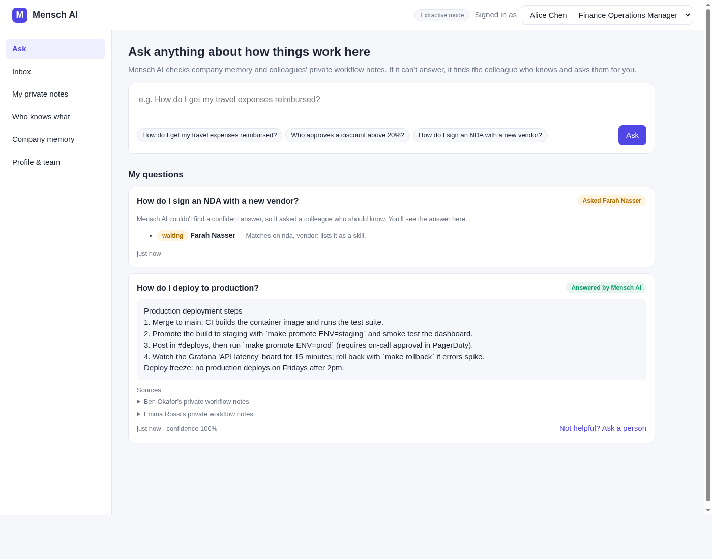

# Mensch AI

An AI agent for companies that helps employees **locate and retrieve information**:

1. **Company memory** – it remembers questions employees ask each other (learned from chat logs, from expert answers, or added manually) and answers repeats instantly.
2. **Private workflow notes** – every employee has a personal notes space for their workflows. Notes are readable **only by the owner and the agent**; when the agent uses one to answer, the asker only sees the relevant excerpt, never the full note.
3. **Who knows what** – the agent maps expertise across the company (from self‑declared skills, answers people gave, and the topics of their notes). When it can't answer confidently, it **finds the right colleague and asks them directly**. Their answer (plus "where to find more") goes back to the asker and into memory, so the next person gets it instantly. If the colleague doesn't know, the agent moves on to the next best person.



## Quick start

```bash
python3 -m venv .venv && source .venv/bin/activate
pip install -r requirements.txt
uvicorn mensch.api:create_app --factory --reload
```

Open http://localhost:8000. A demo company (Acme Robotics, 6 employees with notes and memory) is seeded on first run. Use the **Signed in as** dropdown to switch between employees, e.g.:

- As **Emma**, ask *"How do I get my travel expenses reimbursed?"* → answered from Alice's private notes.
- Ask *"How do I sign an NDA with a new vendor?"* → nobody wrote it down, so the agent asks **Farah** (Legal).
- Switch to **Farah** → **Inbox** → answer it. Switch back to Emma to see the answer; ask again as anyone else and it's answered from memory.

Run the tests with `pytest`.

## Configuration

| Env var | Default | Purpose |
| --- | --- | --- |
| `MENSCH_DATABASE_URL` | `sqlite:///./mensch.db` | SQLAlchemy database URL |
| `MENSCH_SEED_DEMO` | `1` | Seed demo data into an empty database (`0` to disable) |
| `MENSCH_CONFIDENCE_THRESHOLD` | `0.6` | Minimum match confidence for the agent to answer itself instead of asking a colleague |
| `OPENAI_API_KEY` | – | Optional. When set, answers are written by an LLM from the retrieved sources (otherwise extractive) |
| `MENSCH_LLM_MODEL` / `OPENAI_BASE_URL` | `gpt-4o-mini` / OpenAI | LLM model and OpenAI-compatible endpoint |

## How it works

```
question ──► search memory + private notes (BM25, idf-weighted coverage = confidence)
              │
              ├─ confidence ≥ threshold ─► answer with sources (note excerpts only)
              │
              └─ otherwise ─► rank colleagues by expertise profile ─► ExpertRequest to best match
                                 │                                     (inbox, with "why you")
                                 ├─ answered ─► asker notified, saved to memory, boosts expertise
                                 └─ declined ─► next best colleague
```

- `mensch/agent.py` – answering, routing, escalation ("ask a person anyway" goes to the author of the source used)
- `mensch/expertise.py` – expertise profiles and the who-knows-what map
- `mensch/ingest.py` – extract Q&A pairs from chat logs (`[time] Name: message` lines)
- `mensch/text.py` – tokenizer, light stemmer, BM25 (no ML dependencies)
- `mensch/api.py` – FastAPI REST API + serves the web UI in `mensch/static/`

## Current limitations / next steps

- **Auth is a demo user switcher** (`X-User-Id` header). Put SSO (Google/Okta) in front before real use.
- The expertise map shows topic keywords that may be derived from private notes (never their content).
- Integrations to add: Slack/Teams bot (ask + get routed questions in DMs, live chat ingestion), Notion/Confluence/Drive import, embeddings for semantic search.
